# Gallery

Every run from `backend/base/outputs/` (20 so far, 11 with a 3D model). Newest first.

This page is generated by `python tools/build_gallery.py --markdown`. Click any image to see it full size.

### a clean 3D object

`ed8810f02928` · photo · [model.glb](backend/base/outputs/ed8810f02928/model.glb) (download)

| Sketch | Control map | Render | Cutout |
|---|---|---|---|
| <a href="backend/base/outputs/ed8810f02928/sketch.png">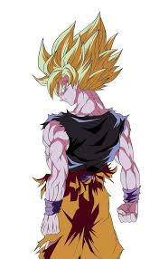</a> | <a href="backend/base/outputs/ed8810f02928/control.png">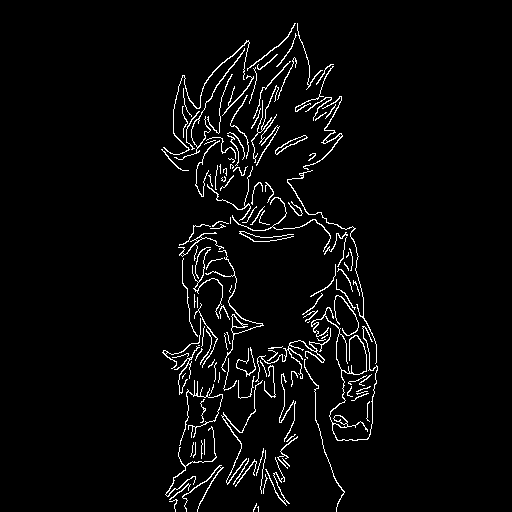</a> |  | <a href="backend/base/outputs/ed8810f02928/foreground.png">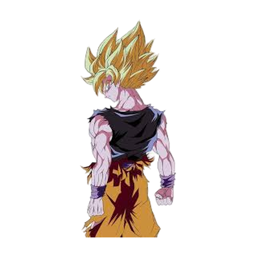</a> |

### a clean 3D object

`33c214a86a82` · photo · no 3D model

| Sketch | Control map | Render | Cutout |
|---|---|---|---|
|  |  |  |  |

### heart

`19dc2b7cfea6` · sketch · no 3D model

| Sketch | Control map | Render | Cutout |
|---|---|---|---|
|  |  | <a href="backend/base/outputs/19dc2b7cfea6/rendered.png">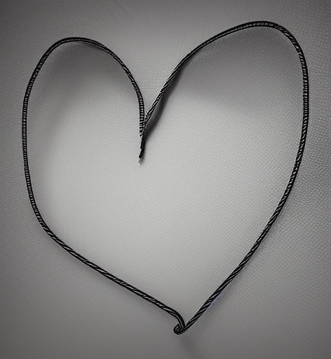</a> | not made |

### cat

`e46b56652600` · photo · [model.glb](backend/base/outputs/e46b56652600/model.glb) (download)

| Sketch | Control map | Render | Cutout |
|---|---|---|---|
|  |  | <a href="backend/base/outputs/e46b56652600/rendered.png">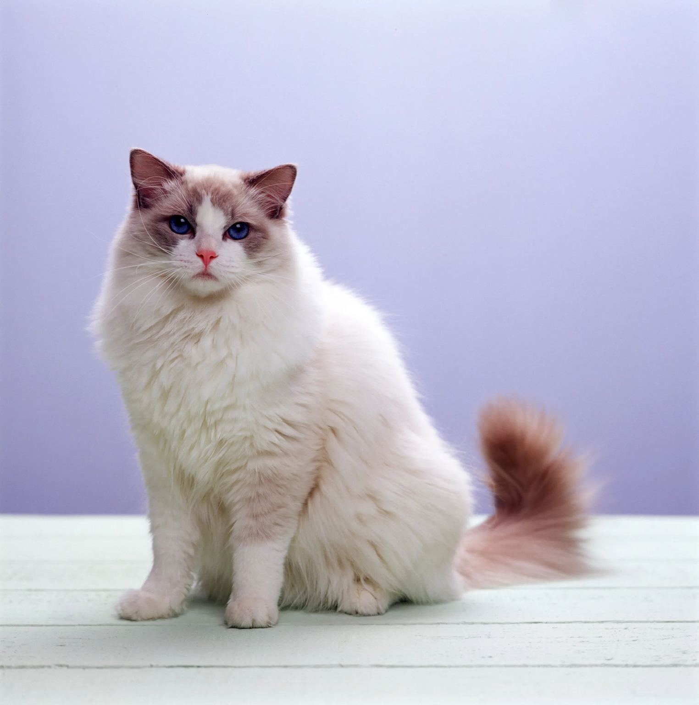</a> | <a href="backend/base/outputs/e46b56652600/foreground.png">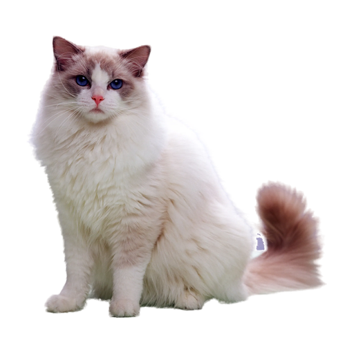</a> |

### cat

`04273e7a21a2` · photo · no 3D model

| Sketch | Control map | Render | Cutout |
|---|---|---|---|
| <a href="backend/base/outputs/04273e7a21a2/sketch.png">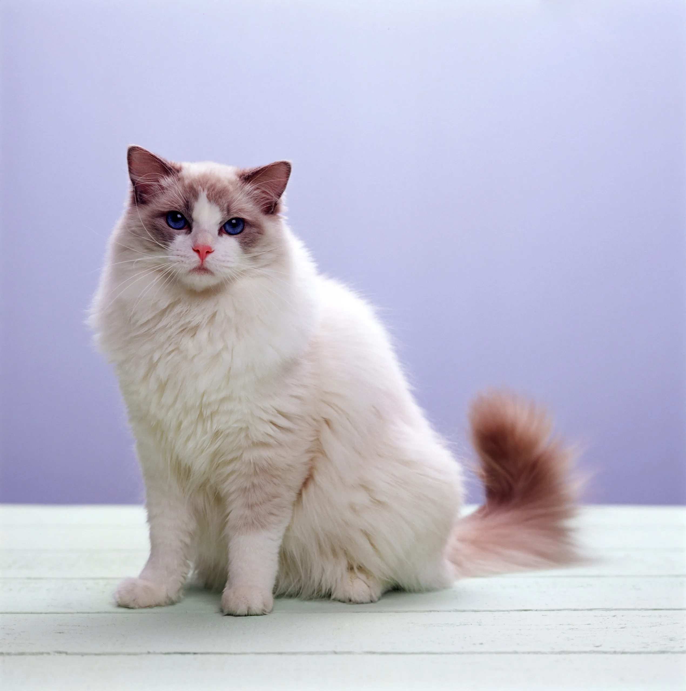</a> | <a href="backend/base/outputs/04273e7a21a2/control.png">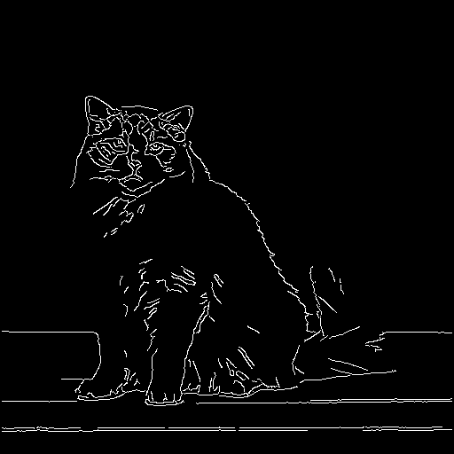</a> |  |  |

### t rex

`03841f9dbfe9` · photo · [model.glb](backend/base/outputs/03841f9dbfe9/model.glb) (download)

| Sketch | Control map | Render | Cutout |
|---|---|---|---|
| <a href="backend/base/outputs/03841f9dbfe9/sketch.png">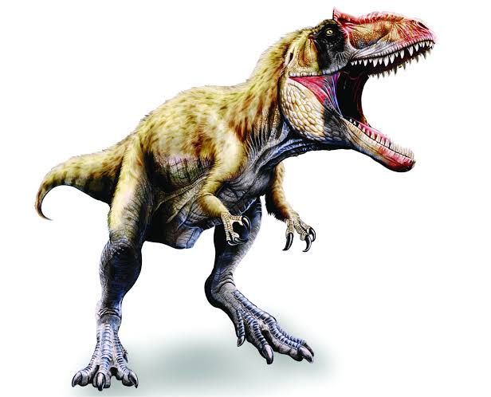</a> | <a href="backend/base/outputs/03841f9dbfe9/control.png">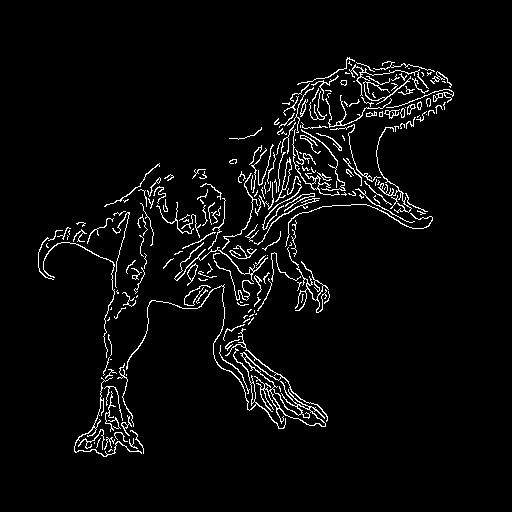</a> |  | <a href="backend/base/outputs/03841f9dbfe9/foreground.png">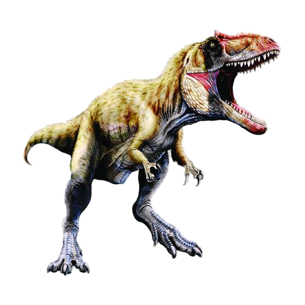</a> |

### red sports car

`e004bf439378` · photo · [model.glb](backend/base/outputs/e004bf439378/model.glb) (download)

| Sketch | Control map | Render | Cutout |
|---|---|---|---|
|  |  |  | <a href="backend/base/outputs/e004bf439378/foreground.png">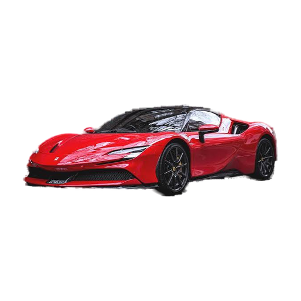</a> |

### car

`f8bcd2ab25df` · photo · no 3D model

| Sketch | Control map | Render | Cutout |
|---|---|---|---|
| <a href="backend/base/outputs/f8bcd2ab25df/sketch.png">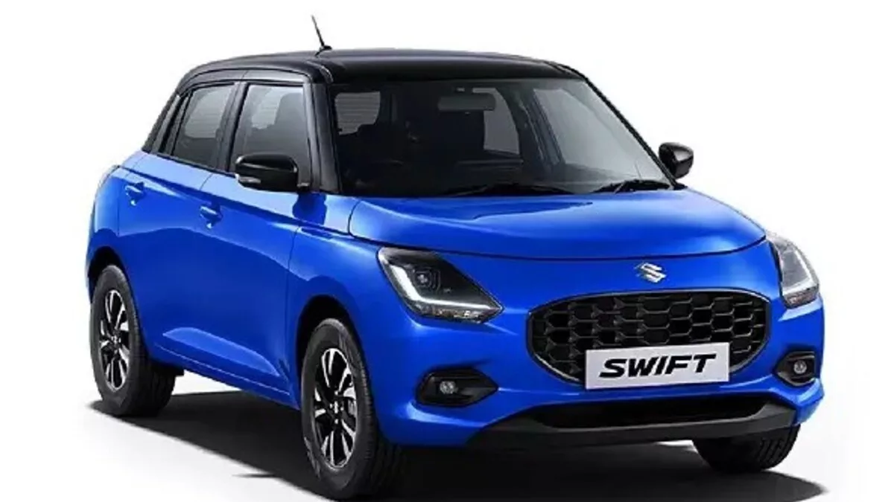</a> | <a href="backend/base/outputs/f8bcd2ab25df/control.png">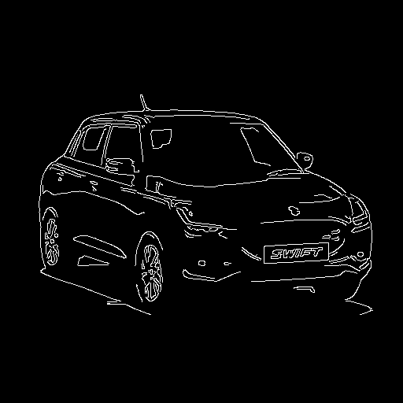</a> |  |  |

### dog

`454d0551db8d` · photo · [model.glb](backend/base/outputs/454d0551db8d/model.glb) (download)

| Sketch | Control map | Render | Cutout |
|---|---|---|---|
|  | <a href="backend/base/outputs/454d0551db8d/control.png">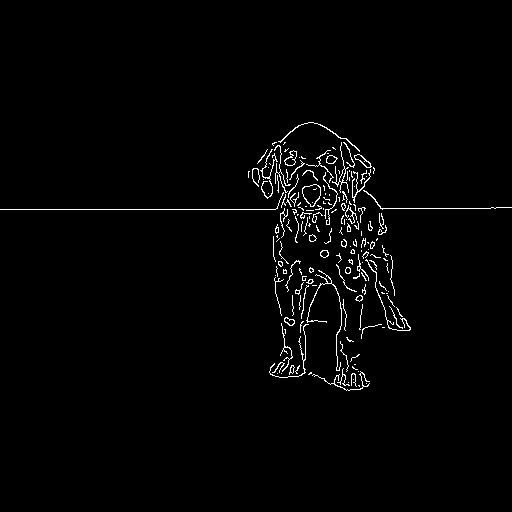</a> | <a href="backend/base/outputs/454d0551db8d/rendered.png">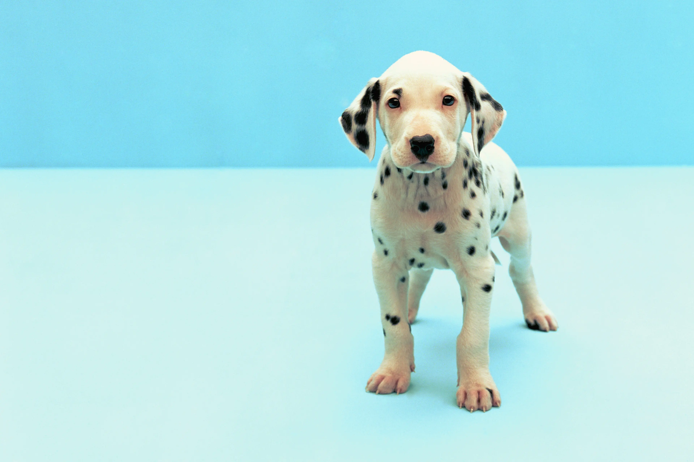</a> | <a href="backend/base/outputs/454d0551db8d/foreground.png">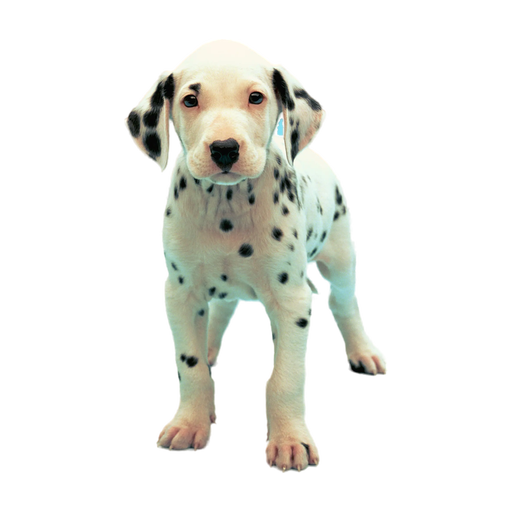</a> |

### a clean 3D object

`0dc681f3de35` · photo · no 3D model

| Sketch | Control map | Render | Cutout |
|---|---|---|---|
| <a href="backend/base/outputs/0dc681f3de35/sketch.png">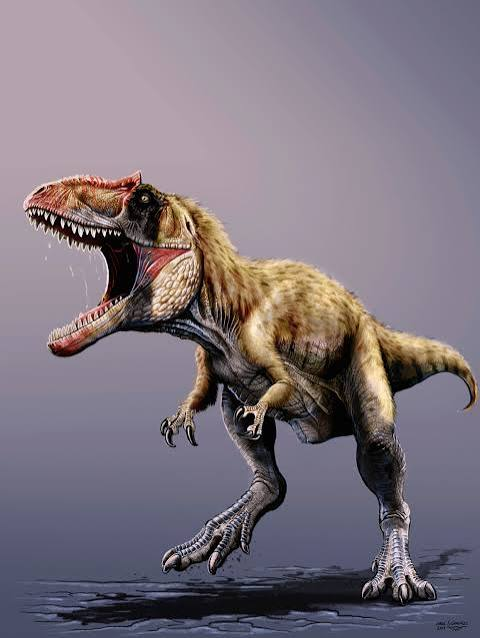</a> | <a href="backend/base/outputs/0dc681f3de35/control.png">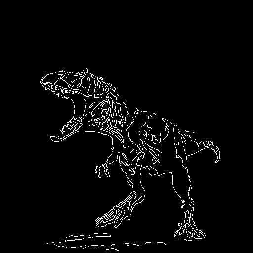</a> |  | <a href="backend/base/outputs/0dc681f3de35/foreground.png">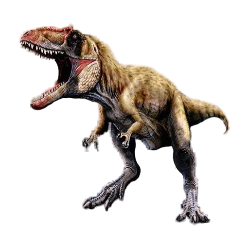</a> |

### a clean 3D object

`c0988129d924` · photo · [model.glb](backend/base/outputs/c0988129d924/model.glb) (download)

| Sketch | Control map | Render | Cutout |
|---|---|---|---|
| <a href="backend/base/outputs/c0988129d924/sketch.png">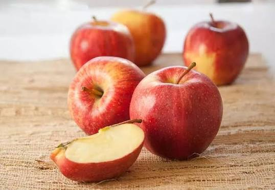</a> | <a href="backend/base/outputs/c0988129d924/control.png">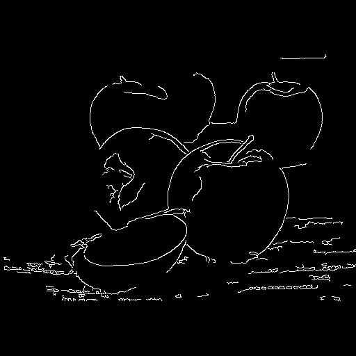</a> |  | <a href="backend/base/outputs/c0988129d924/foreground.png">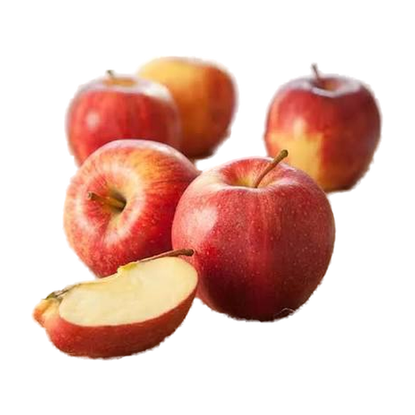</a> |

### a  red ball

`43bc3b7f78aa` · sketch · no 3D model

| Sketch | Control map | Render | Cutout |
|---|---|---|---|
| <a href="backend/base/outputs/43bc3b7f78aa/sketch.png">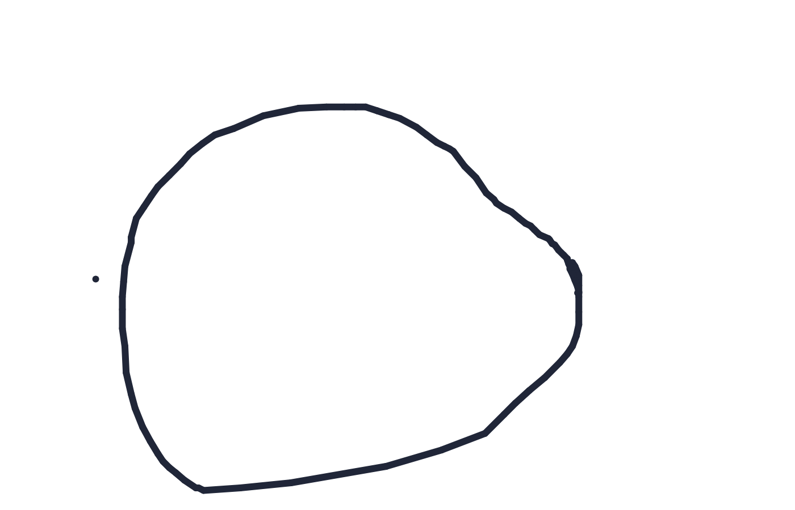</a> | <a href="backend/base/outputs/43bc3b7f78aa/control.png">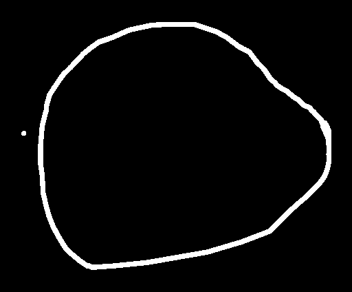</a> | <a href="backend/base/outputs/43bc3b7f78aa/rendered.png">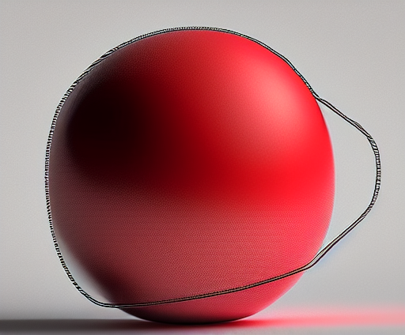</a> | <a href="backend/base/outputs/43bc3b7f78aa/foreground.png">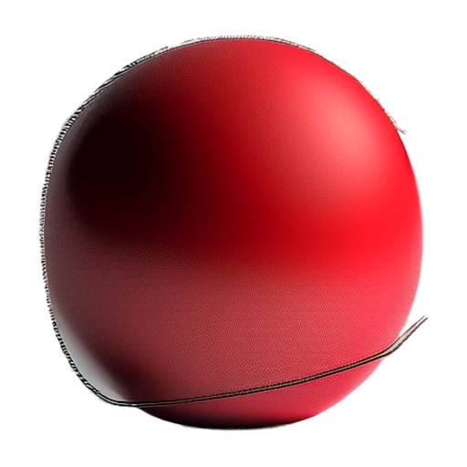</a> |

### a  red ball

`3cb907f28185` · sketch · no 3D model

| Sketch | Control map | Render | Cutout |
|---|---|---|---|
|  | <a href="backend/base/outputs/3cb907f28185/control.png">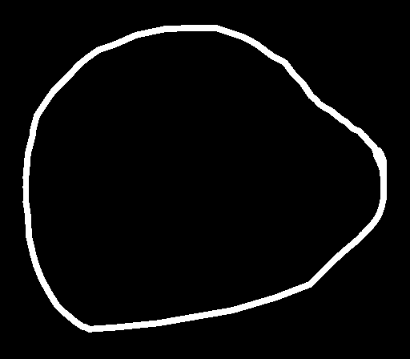</a> | <a href="backend/base/outputs/3cb907f28185/rendered.png">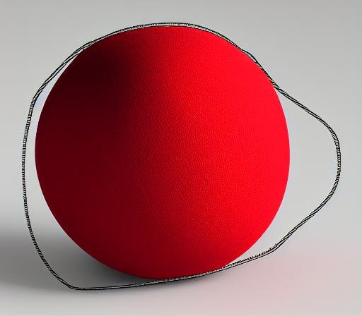</a> | <a href="backend/base/outputs/3cb907f28185/foreground.png">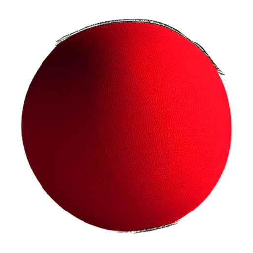</a> |

### a yellow heart

`302240e9ae53` · sketch · [model.glb](backend/base/outputs/302240e9ae53/model.glb) (download)

| Sketch | Control map | Render | Cutout |
|---|---|---|---|
| <a href="backend/base/outputs/302240e9ae53/sketch.png">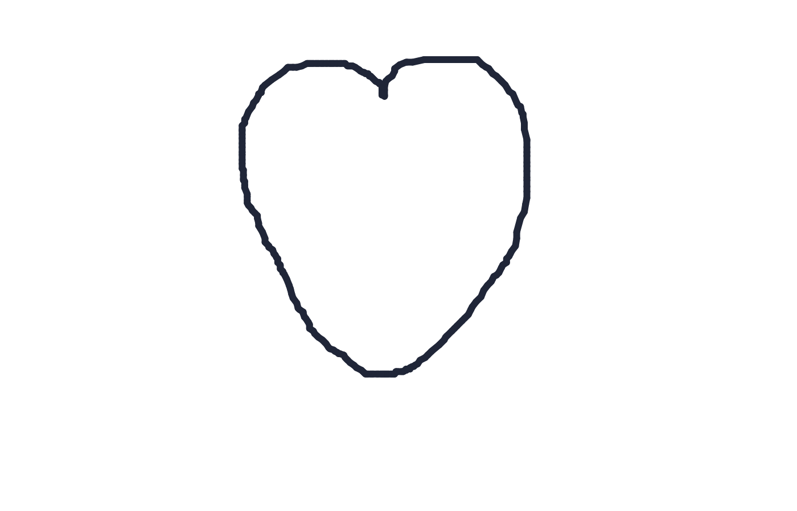</a> | <a href="backend/base/outputs/302240e9ae53/control.png">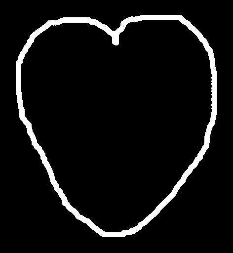</a> | <a href="backend/base/outputs/302240e9ae53/rendered.png">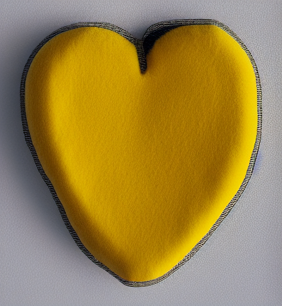</a> | <a href="backend/base/outputs/302240e9ae53/foreground.png">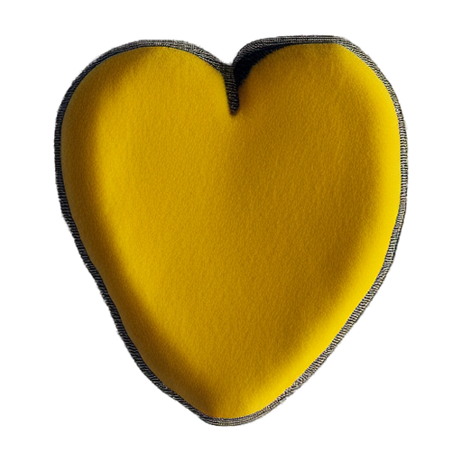</a> |

### a bright yellow heart

`66217665f050` · sketch · [model.glb](backend/base/outputs/66217665f050/model.glb) (download)

| Sketch | Control map | Render | Cutout |
|---|---|---|---|
| <a href="backend/base/outputs/66217665f050/sketch.png">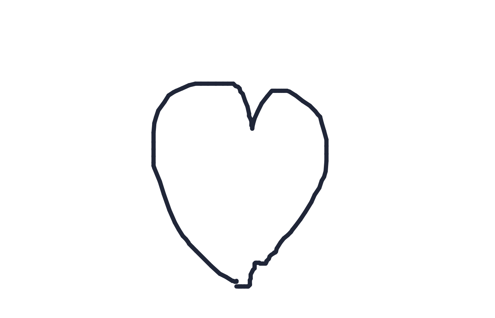</a> | <a href="backend/base/outputs/66217665f050/control.png">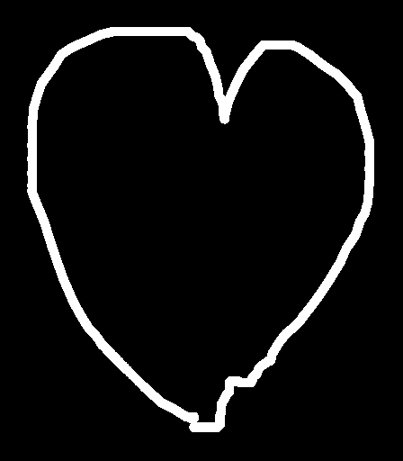</a> | <a href="backend/base/outputs/66217665f050/rendered.png">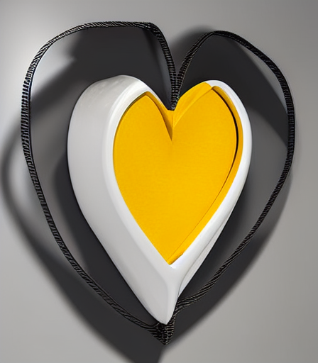</a> | <a href="backend/base/outputs/66217665f050/foreground.png">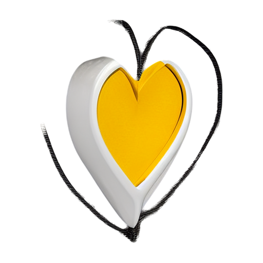</a> |

### Red apples

`aded018e27b1` · photo · [model.glb](backend/base/outputs/aded018e27b1/model.glb) (download)

| Sketch | Control map | Render | Cutout |
|---|---|---|---|
|  |  |  |  |

### a clean 3D object

`0880258f9a6e` · photo · [model.glb](backend/base/outputs/0880258f9a6e/model.glb) (download)

| Sketch | Control map | Render | Cutout |
|---|---|---|---|
|  | <a href="backend/base/outputs/0880258f9a6e/control.png">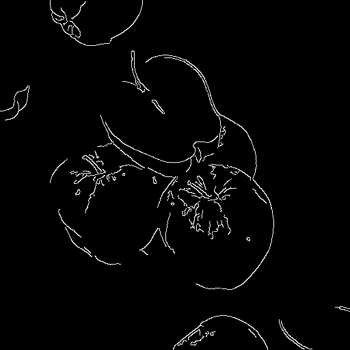</a> |  | <a href="backend/base/outputs/0880258f9a6e/foreground.png">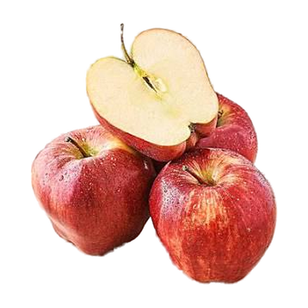</a> |

### a clean 3D object

`7e020cfae599` · photo · no 3D model

| Sketch | Control map | Render | Cutout |
|---|---|---|---|
| <a href="backend/base/outputs/7e020cfae599/sketch.png">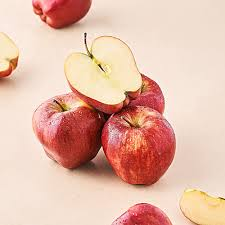</a> |  |  | <a href="backend/base/outputs/7e020cfae599/foreground.png">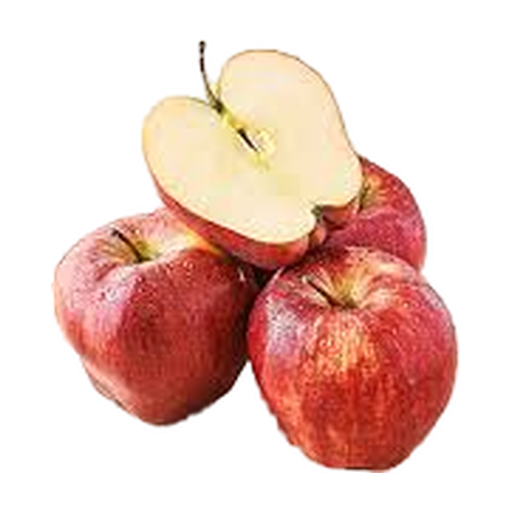</a> |

### red apples

`094b4e845dc8` · photo · no 3D model

| Sketch | Control map | Render | Cutout |
|---|---|---|---|
|  | <a href="backend/base/outputs/094b4e845dc8/control.png">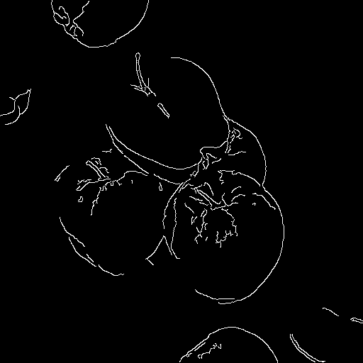</a> |  |  |

### a golden brown dog

`976187d72341` · photo · [model.glb](backend/base/outputs/976187d72341/model.glb) (download)

| Sketch | Control map | Render | Cutout |
|---|---|---|---|
| <a href="backend/base/outputs/976187d72341/sketch.png">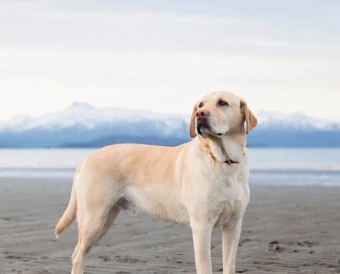</a> | <a href="backend/base/outputs/976187d72341/control.png">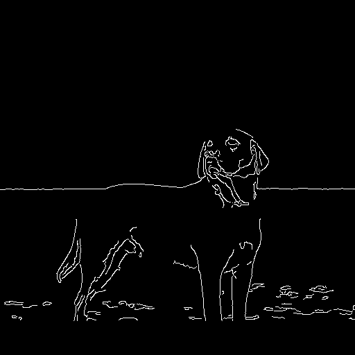</a> |  | <a href="backend/base/outputs/976187d72341/foreground.png">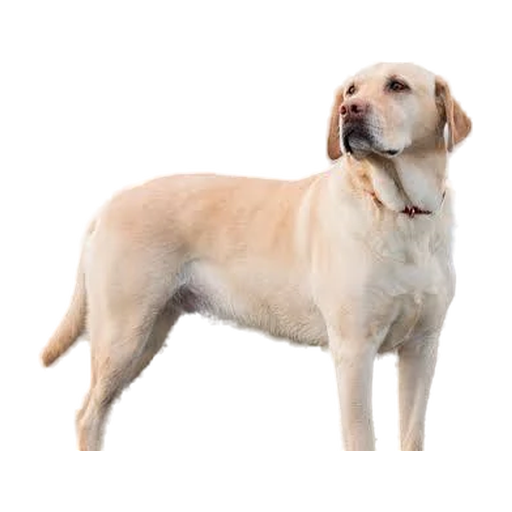</a> |
