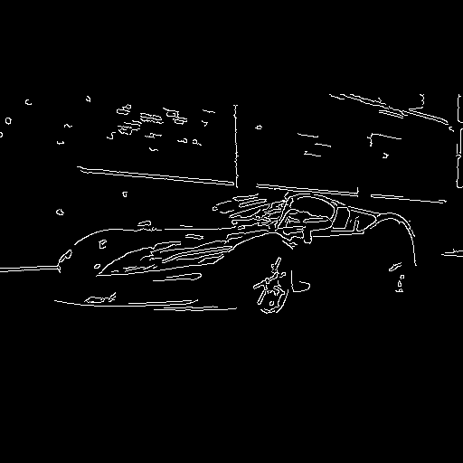
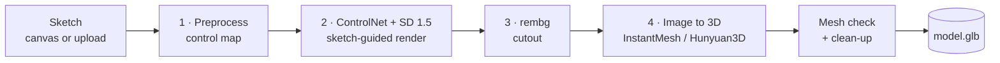
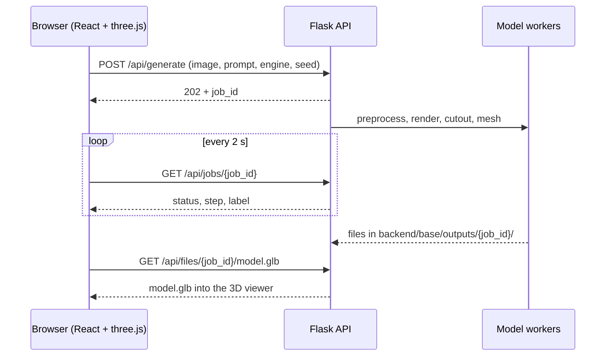

<div align="center">

# Sketch2Shape AI

**Draw a rough idea. Get a real 3D model.**

Sketch → ControlNet render → background removal → 3D mesh → mesh check → GLB viewer


[Showcase](#showcase) · [Gallery](GALLERY.md) · [Quick start](#quick-start) · [How it works](#how-it-works) · [Performance](#performance-measured) · [Limitations](#limitations)

<p>
  
  
  
  
</p>
<sub>Sketch · control map · render · cutout, then a mesh you can spin in the browser. Real output of this pipeline, untouched.</sub>

</div>

---

## Overview

Sketch2Shape AI turns a single-view 2D sketch into an exportable 3D asset. You draw on a
built-in canvas or upload an image, optionally add a short text prompt, and the app
interprets the sketch, renders the object, isolates it and reconstructs a mesh you can
orbit in the browser and download as `.glb`.

**Pipeline:** sketch -> ControlNet render -> background removal -> 3D mesh (InstantMesh or Hunyuan3D) -> mesh check + clean-up -> GLB viewer.

Every exported file is opened and checked before a job counts as done (non-empty
geometry, finite vertices, real 3D volume). The result page shows what was found
(faces, and whether the file has a texture, vertex colours, or is shape only).

Built for the TechZephyr 4.0 *Sketch2Shape AI* problem statement. No model was trained or
fine-tuned for this project. Every pretrained model and external service is disclosed in
[Models, external services and licences](#models-external-services-and-licences).

## Showcase

Everything below is real output from our own runs, copied unchanged from
`backend/base/outputs/<job_id>/`.

### Car (no prompt, job `583e17253c09`)

| Sketch | Control map | Rendered | Cutout |
|---|---|---|---|
|  |  |  |  |

Final mesh: [`model.glb`](frontend/public/examples/car/model.glb) (about 3.2 MB).

### Apples (prompt `Apples`, job `0dcebb7e35bf`)

| Sketch | Control map | Rendered | Cutout |
|---|---|---|---|
|  |  |  |  |

Final mesh: [`model.glb`](frontend/public/examples/heart/model.glb) (about 4.7 MB).

### The outputs folder: every run, every stage

These two are only the curated pair. The app writes **one self-contained folder per job**
into `backend/base/outputs/`, and that folder holds the results of all our test runs:
sketches of different objects, with and without prompts, drawn on the canvas and uploaded as
photos, through each 3D engine. Open any folder to see how a single sketch moved through the pipeline.

```
backend/base/outputs/
└── <job_id>/
    ├── control.png      stage 1  control map (512 px, white lines on black)
    ├── rendered.png     stage 2  sketch-guided render (skipped for photos)
    ├── foreground.png   stage 3  RGBA cutout, square, centred
    ├── model.glb        stage 4  final mesh after check + clean-up
    └── model_raw.glb             the untouched export from the 3D engine
```

Per-stage timings for each job are in `backend/logs/jobs/<job_id>.log`.

**[Browse the full gallery of every run](GALLERY.md)**: every sketch, control map, render and
cutout from `backend/base/outputs/`, newest first, with a download link for each mesh. It is
regenerated whenever new job folders are pushed, so it grows with the outputs.
To rebuild it by hand, run `python tools/build_gallery.py --markdown`. For an interactive
version with a 3D viewer, run `python tools/build_gallery.py` and open `_site/index.html`.

Count the runs we made:

```
# PowerShell
(Get-ChildItem backend\base\outputs -Directory).Count

# macOS / Linux
ls backend/base/outputs | wc -l
```

Open any `model.glb` in Blender (*File -> Import -> glTF 2.0*), the Windows 3D Viewer, or any
glTF viewer. Inside the app, the Studio page loads and exports the same files.

## How it works



| Stage | What happens | Model or tool | Output |
|---|---|---|---|
| 1. Preprocess | Pads to a square, classifies sketch vs photo, builds the control map (Otsu + line thickening for sketches, Canny for photos). An empty sketch is rejected with a clear message. | OpenCV, Pillow, NumPy | `control.png` |
| 2. Render | Sketch-guided image generation. The prompt styles the object, the strokes keep its shape. Photos skip this stage by default. | Stable Diffusion 1.5 + ControlNet Scribble / Canny | `rendered.png` |
| 3. Cutout | Removes the background, cleans the mask, centres the object and fills about 85% of a square frame. | rembg (BiRefNet, then ISNet, then U2Net) | `foreground.png` |
| 4. Image to 3D | Tries the selected engine, or the whole fallback chain in Auto mode. | InstantMesh (local or API), Hunyuan3D-2mini | `model_raw.glb` |
| 5. Check + clean-up | Opens the file, verifies geometry, removes floating specks, centres and scales, decimates uncoloured meshes. | trimesh | `model.glb` |

How one run travels between the three layers (browser, Flask API, model workers):



Design choices worth knowing:

- **Job polling, not one long request.** A run takes minutes, so the browser submits once and polls. Progress is visible and nothing times out.
- **Heavy models run in their own processes.** Hunyuan3D and InstantMesh pin their own library versions, so they get separate environments. That keeps the backend env clean and frees all VRAM when they exit.
- **Fallback chain for the mesh step.** A missing install, a full GPU or an API quota error moves on to the next engine instead of failing the job.
- **The sketch stays the source of truth.** ControlNet conditions on your strokes, so the prompt styles the object rather than replacing it.
- **One GPU job at a time.** A lock queues requests, which avoids out-of-memory crashes on a single GPU.

## What the problem statement asked for, and where it is

| Requirement | How Sketch2Shape covers it |
|---|---|
| In-app sketching | Canvas with brush, eraser, colours, brush size, undo, redo and clear |
| Image upload | PNG, JPG or WEBP, up to 15 MB |
| Optional text prompt | Up to 400 characters, never required |
| Input preparation | Stage 1: square padding, sketch/photo detection, thresholding, edge maps |
| Sketch-guided generation | Stable Diffusion 1.5 with ControlNet (Scribble for drawings, Canny for photos) |
| Background removal | rembg with BiRefNet, falling back to ISNet and U2Net |
| 3D reconstruction | InstantMesh (local or API) and Hunyuan3D-2mini, with automatic fallback |
| Export as `.glb` or `.obj` | `.glb` export, and the viewer also opens `.obj` |
| Mesh validation | Every export is reopened and checked (non-empty geometry, finite vertices, real volume). `mesh_stats` reports the result |
| Preview and download | Embedded three.js viewer (orbit, zoom, pan, fullscreen) and an Export button |
| Disclose models and services | [Models, external services and licences](#models-external-services-and-licences) |
| Report time, hardware, limitations | [Performance](#performance-measured) and [Limitations](#limitations) |
| Example inputs and outputs | [Showcase](#showcase) and `backend/base/outputs/` |

## Requirements

- NVIDIA GPU strongly recommended (CPU works but is very slow). Tested on an RTX 4050 laptop GPU
- Windows (tested); macOS/Linux should work for the backend and frontend
- Python 3.13 for the backend; Hunyuan3D and local InstantMesh use their own envs (see below)
- Node 18 or newer for the frontend

## Quick start

The shortest path to a working run. It needs no extra environments: engines that are not
set up are skipped, and the job uses the InstantMesh Hugging Face Space
(`instantmesh_api`), which is an **external service** (internet required, free
`HF_TOKEN` recommended).

**Backend** (terminal 1, PowerShell)

```
cd ./backend
python -m venv .venv
.venv\Scripts\activate
pip install torch --index-url https://download.pytorch.org/whl/cu121
pip install -r ../requirements.txt
$env:HF_TOKEN="hf_xxxxxxxx"        # your own free Hugging Face token
python app.py
```

**Frontend** (terminal 2)

```
cd ./frontend
npm install
npm run dev
```

Open http://localhost:5173. The status light in the top bar turns green when
the model is loaded. The first start downloads several GB of weights.

Then open **Studio**, draw one object (dark lines, white background), press *Generate 3D model*,
and expect a finished model in roughly 4 to 6 minutes on a laptop GPU. Use *Export GLB* to download it.

## Full local setup

For fully local runs (no external service), install the engines below and point the backend
at them. Adjust the paths to your machine.

**Backend** (terminal 1, PowerShell)

```
cd ./backend
.venv\Scripts\activate
$env:HF_TOKEN="hf_xxxxxxxx"        # your own free Hugging Face token
$env:S2S_HY_PYTHON="C:\path\to\Hunyuan3D-2\.venv\Scripts\python.exe"
$env:S2S_IM_DIR="C:\path\to\InstantMesh"
$env:S2S_IM_PYTHON="C:\path\to\InstantMesh\.venv\Scripts\python.exe"
$env:S2S_IM_CONFIG="configs/lowvram/instant-mesh-base.yaml"
$env:S2S_LOW_VRAM="1"
$env:PYTORCH_CUDA_ALLOC_CONF="max_split_size_mb:128"
# optional: override the engine order (default: instantmesh_local,instantmesh_api,hunyuan)
# $env:S2S_MESH="hunyuan,instantmesh_local,instantmesh_api"

# NVIDIA GPU? install the CUDA torch FIRST (pick your CUDA version on pytorch.org):
pip install torch --index-url https://download.pytorch.org/whl/cu121
pip install -r ../requirements.txt
python app.py
```

The frontend is started the same way as in the quick start.

## Using the app

**Inputs**

- A sketch drawn on the canvas, or an uploaded PNG / JPG / WEBP (up to 15 MB)
- An optional prompt (up to 400 characters) for colour, material or style
- An optional 3D engine choice (Auto tries them in order) and an optional seed

**Outputs**

- `model.glb` (or `.obj`) that opens in Blender and other 3D software
- The intermediate images of every stage, plus a mesh report: faces, and whether the model is textured, vertex-coloured or shape only

Tip: draw one object, dark lines, white background, no scribbled shading.

## Troubleshooting

| Symptom | Cause | Fix |
|---|---|---|
| Generation is very slow, log says `No CUDA GPU detected` | torch installed without CUDA | reinstall torch with the CUDA index URL above |
| The shared InstantMesh Space queues or rejects you | No `HF_TOKEN` | create a free token at huggingface.co/settings/tokens |
| Out of memory on a small GPU | Little VRAM | start with `S2S_LOW_VRAM=1` and the `lowvram` InstantMesh config |
| Status light says *Model loading* | First start is downloading weights | wait; it turns green when loading finishes |
| Status light says *API offline* | Backend is not running or not reachable | start `python app.py` in `backend`; the frontend proxies `/api` to `127.0.0.1:8000` |

On CPU the app switches to a fast 6-step sampler automatically (`S2S_FAST=auto`).
Force it with `S2S_FAST=1`, or turn it off with `S2S_FAST=0` for slightly better quality.

## Settings (environment variables)

| Variable | Default | Meaning |
|---|---|---|
| `HF_TOKEN` | none | Hugging Face token for the InstantMesh Space |
| `S2S_MESH` | `instantmesh_local,instantmesh_api,hunyuan` | 3D backends, in the order they are tried (see below) |
| `S2S_SEED` | 42 | Default seed for the render and the 3D engines. The Studio page can send its own per job |
| `S2S_POST` | 1 | `0` skips the mesh clean-up (specks, centring, unit scale, decimation) |
| `S2S_MAX_FACES` | 100000 | Meshes without colour above this face count are decimated (needs `fast-simplification`) |
| `S2S_MIN_PART` | 0.01 | Floating pieces smaller than this fraction of the biggest piece are removed |
| `S2S_HY_PYTHON` | backend python | `python.exe` of the Hunyuan3D env |
| `S2S_HY_OCT` | 256 | Hunyuan mesh detail, lower = less VRAM |
| `S2S_IM_DIR` | none | folder of your InstantMesh clone, turns on local InstantMesh |
| `S2S_IM_PYTHON` | backend python | `python.exe` of the InstantMesh env |
| `S2S_IM_CONFIG` | `configs/instant-mesh-large.yaml` | `configs/instant-mesh-base.yaml` is lighter on VRAM |
| `S2S_FAST` | `auto` | LCM-LoRA sampler (6 steps). On when no GPU |
| `S2S_STEPS` | 20 (6 fast) | diffusion steps for the render |
| `S2S_MVS_STEPS` | 50 | InstantMesh multi-view steps (30-75), API and local |
| `S2S_LOW_VRAM` | off | CPU offload for small GPUs |
| `S2S_REMBG_MODEL` | `birefnet-general` | falls back to `isnet-general-use`, then `u2net` |

## 3D backends

The last step (cutout -> mesh) has three backends. They are tried in order and
the next one is used when one fails:

| Name | What | Needs |
|---|---|---|
| `instantmesh_local` | InstantMesh on your GPU, vertex colours | `S2S_IM_DIR`, `S2S_IM_PYTHON` (its own env) |
| `instantmesh_api` | InstantMesh on the Hugging Face Space, vertex colours (external service) | internet, `HF_TOKEN` recommended |
| `hunyuan` | Hunyuan3D-2mini on your GPU, shape only (plain grey, no colour) | `S2S_HY_PYTHON` (its own env) |

Default order: `instantmesh_local,instantmesh_api,hunyuan`. The coloured engines
come first and Hunyuan is the shape-only last resort. A backend that is not set
up (for example no `S2S_IM_DIR`) is skipped, and a backend whose file is empty or
corrupt counts as failed, so the next one is tried. Change the order with
`S2S_MESH`. A single name turns the fallback off:

```
$env:S2S_MESH="hunyuan"                    # Hunyuan only (fastest to set up, no colour)
$env:S2S_MESH="hunyuan,instantmesh_api"    # Hunyuan first, API as fallback
```

(`instantmesh` still works as an alias of `instantmesh_api`.) The backend
prints the active order at start, and a finished job reports which backend made
it in the `backend` field of `/api/jobs/<id>`.

<details>
<summary><b>Hunyuan3D setup (shape-only engine)</b></summary>

<br />

Hunyuan3D runs in its own environment, started by the backend as a separate process.

1. Clone the repo and make an env (PowerShell):

```
git clone https://github.com/Tencent/Hunyuan3D-2.git
cd Hunyuan3D-2
python -m venv .venv
.venv\Scripts\activate
```

2. Install CUDA torch first, then the repo:

```
pip install torch --index-url https://download.pytorch.org/whl/cu121
pip install -r requirements.txt
pip install -e .
```

   Only the shape model is used, so the texture extensions (custom_rasterizer,
   differentiable_renderer) do NOT need to be built.

3. Check the install:

```
python -c "from hy3dgen.shapegen import Hunyuan3DDiTFlowMatchingPipeline; print('ok')"
```

4. Point the backend at it before `python app.py`:

```
$env:S2S_HY_PYTHON="C:\path\to\Hunyuan3D-2\.venv\Scripts\python.exe"
```

The model weights (`tencent/Hunyuan3D-2mini`) download automatically on the first
job, so that run is slower. If it runs out of memory, lower `S2S_HY_OCT` (e.g. 192).

</details>

<details>
<summary><b>Local InstantMesh setup</b></summary>

<br />

InstantMesh pins its own torch / diffusers versions and builds nvdiffrast, so it
needs a separate environment, not the backend one.

1. Clone https://github.com/TencentARC/InstantMesh and follow its install steps
   in a new env (Python 3.10, CUDA 12.1 torch, xformers,
   `pip install -r requirements.txt`). nvdiffrast is built from source, which on
   Windows needs the CUDA toolkit and the Visual Studio build tools.
2. Check it on its own first (the first run downloads the models):
   `python run.py configs/instant-mesh-large.yaml examples/hatsune_miku.png`
3. Point the backend at it, then start `python app.py`:

```
$env:S2S_IM_DIR="C:\path\to\InstantMesh"
$env:S2S_IM_PYTHON="C:\path\to\instantmesh-env\Scripts\python.exe"
```

It needs an NVIDIA GPU. If it runs out of memory, use
`$env:S2S_IM_CONFIG="configs/instant-mesh-base.yaml"` (or the `lowvram` config).

</details>

## API

- `POST /api/generate` (multipart `image`, optional `prompt`, `backend`, `seed`) -> `{job_id}`
- `GET /api/jobs/<job_id>` -> `status` (`queued`, `running`, `done`, `error`, `cancelled`), `label`, `step`, `model_url`, `backend`, `seed`, `mesh_stats`
- `POST /api/jobs/<job_id>/cancel` -> stops the job (the Hunyuan / local InstantMesh process is terminated)
- `GET /api/files/<job_id>/model.glb` (the untouched export is kept as `model_raw.glb`)
- `GET /api/health`

`mesh_stats` holds `vertices`, `faces`, `extent`, `watertight`, `file_bytes` and `look`
(`textured`, `vertex_colors` or `shape_only`).

## Models, external services and licences

No model was trained or fine-tuned for this project; everything below is used as released.
Check each licence before you redistribute anything.

| Component | Identifier in code | Used for | Licence | Source |
|---|---|---|---|---|
| Stable Diffusion 1.5 | `stable-diffusion-v1-5/stable-diffusion-v1-5` | Render from the control image | CreativeML OpenRAIL-M | https://huggingface.co/stable-diffusion-v1-5/stable-diffusion-v1-5 |
| ControlNet Canny | `lllyasviel/sd-controlnet-canny` | Edge-guided render (photos) | CreativeML OpenRAIL-M | https://huggingface.co/lllyasviel/sd-controlnet-canny |
| ControlNet Scribble | `lllyasviel/sd-controlnet-scribble` | Sketch-guided render | CreativeML OpenRAIL-M | https://huggingface.co/lllyasviel/sd-controlnet-scribble |
| LCM-LoRA | `latent-consistency/lcm-lora-sdv1-5` | Fast 6-step sampler (CPU mode only) | OpenRAIL++ | https://huggingface.co/latent-consistency/lcm-lora-sdv1-5 |
| rembg + BiRefNet | `birefnet-general` | Background removal (default) | MIT | https://github.com/danielgatis/rembg |
| rembg fallbacks | `isnet-general-use`, `u2net` | Background removal fallbacks | Apache-2.0 | https://github.com/danielgatis/rembg |
| InstantMesh | `TencentARC/InstantMesh` (local repo, and the Hugging Face Space, **external API**) | Image to coloured 3D mesh | Apache-2.0 | https://github.com/TencentARC/InstantMesh |
| Hunyuan3D-2mini | `tencent/Hunyuan3D-2mini` | Image to shape-only 3D mesh | Tencent Hunyuan 3D 2.0 Community License | https://huggingface.co/tencent/Hunyuan3D-2mini |
| Libraries | Flask, diffusers, transformers, OpenCV, Pillow, NumPy, trimesh, gradio_client, React, Vite, three.js | Application | see each project | |

Notes:

- **Hunyuan3D licence:** it does not apply in the European Union, the United Kingdom and South Korea,
  it has a monthly-active-user threshold for large services, and its output may not be used to
  improve other AI models. Read it at https://huggingface.co/tencent/Hunyuan3D-2/blob/main/LICENSE.
- **External service:** the `instantmesh_api` engine sends your cutout to the public
  `TencentARC/InstantMesh` Hugging Face Space. It needs internet and may be queued or rate limited.
  `HF_TOKEN` is optional but raises the quota.
- **Weights:** all models download from Hugging Face on first use (several GB in total) into the
  normal Hugging Face cache.

## Performance (measured)

Hardware used for the numbers below:

| Item | Value |
|---|---|
| GPU | NVIDIA GeForce RTX 4050 Laptop GPU (6 GB VRAM) |
| OS | Windows |
| Python | 3.13, torch CUDA build |
| CPU, system RAM, torch version | (fill in) |

Render model on CUDA in fp16, 20 steps (`S2S_FAST` off), with the environment settings
shown under "Full local setup".

Times in seconds, taken from `backend/logs/jobs/<id>.log` (one finished job each):

| Input | Engine | Preprocess | Render | Cutout | Mesh | Total |
|---|---|---|---|---|---|---|
| Heart sketch (canvas) | Hunyuan3D (shape only) | 0.3 | 39.0 | 124.4 | 173.3 | 337 |
| Heart sketch (canvas) | InstantMesh (local) | 0.2 | 36.7 | 117.2 | 229.0 | 383 |
| Red apples photo (upload) | Hunyuan3D (shape only) | 0.3 | 0.1 (skipped) | 85.2 | 163.5 | 249 |

- Expect roughly 4 to 6 minutes per model on this machine. The first run is slower because weights download.
- The mesh stage includes starting a fresh Python process and loading the model every time.
- Background removal is the slowest stage after the mesh. `rembg[cpu]` (in `requirements.txt`) uses the CPU onnxruntime build.
- These runs were measured before the check + clean-up step was added; it adds a few seconds.

## Limitations

- One photo-like view cannot define hidden surfaces, so the back and underside are inferred by the model.
- Output is a viewing/prototyping mesh, not print-ready or production topology.
- Colour depends on the engine: InstantMesh writes vertex colours, Hunyuan3D-2mini writes plain grey geometry. No UV texture maps are produced.
- Needs an NVIDIA GPU for reasonable speed. On CPU the render uses a 6-step LCM sampler and is slow.
- Small GPUs (about 6 GB) can run out of memory with local InstantMesh; use the `lowvram` config and `S2S_LOW_VRAM=1`, or let Auto fall back to the API or Hunyuan.
- One job runs at a time (a lock serialises GPU use); other jobs wait in the queue.
- The `instantmesh_api` engine depends on a Hugging Face Space: availability, quota and its endpoints (`/preprocess`, `/generate_mvs`, `/make3d`) are outside this project's control. A cancelled API job stops on our side, the remote call finishes on its own.
- The prompt only influences the render stage. Uploads classified as photos skip the render stage and ignore the prompt.
- Stable Diffusion 1.5 renders can deviate from rough sketches, especially without a prompt.
- Jobs are kept in memory and their files are deleted after 6 hours; job ids do not survive a restart.
- Results use fixed seeds (`S2S_SEED`, default 42) but GPU kernels can still differ slightly between machines.
- The clean-up step only decimates meshes without colour (decimation would drop vertex colours) and leaves meshes with a texture image untouched.

## Tests

```
pip install pytest
python -m pytest tests -q
```

---

<div align="center">

Built by **Team Tabahi** for **TechZephyr 4.0** · IIT Bhubaneswar · 2026

</div>